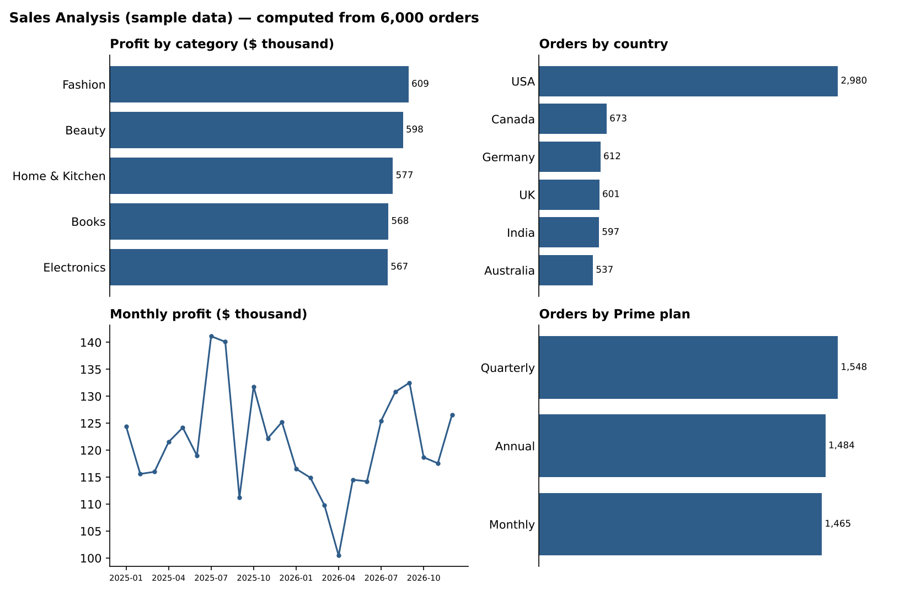

# 🛒 Project 3 — Sales Analysis Dashboard

An e-commerce sales and profitability dashboard over **6,000 orders** — products, categories, countries, delivery performance, returns, Prime membership and customer behaviour.

> **Data note:** this is *sample / synthetic* e-commerce data created for practice. It is not real Amazon data and the project is not affiliated with any retailer.

## Brief
> Analyse sales, profit, products and monthly performance using `XLOOKUP`, `INDEX-MATCH`, `IFERROR`, PivotTables, Power Query and charts.
> — [project brief](../docs/Basic_to_Advanced_Excel_Projects_Brief.docx)

## Dataset — `Amazon_Sales_Data`
6,000 orders · 21 fields: order date, month, year, order ID, customer, city, state, country, latitude/longitude, product, category, Prime plan, delivered date, return status, quantity, **order amount, shipping charges, cost price, profit, profit margin %**.

Coverage: 1,476 customers · 10 cities · 10 states · 6 countries · 5 categories · 3 Prime plans (plus "None").

## Workbook structure
| Sheet | Purpose |
|---|---|
| **Executive Overview** | Headline sales, profit, orders, margin |
| **Product Performance** | Best-selling and most profitable products, category comparison |
| **Customer & Prime Analysis** | Repeat vs one-time customers, Prime plan mix |
| Delivery / working pages | Average, fastest and slowest delivery days; cities, states and countries served |
| `Amazon_Sales_Data` | Source Excel Table (`AmazonSales`) with calculated month/year and conditional formatting |

Power Query connections (`AmazonSales34`, `Customer Detail`) feed a **Data Model** for distinct-customer counts. 30 PivotTables · 17 charts · 4 slicers · KPI cards built with `XLOOKUP`, `MAX`, `MIN`, `AVERAGE`.

## Key figures
| Metric | Value |
|---|---|
| Orders | **6,000** |
| Order amount | **$9.71M** |
| Profit | **$2.92M** (margin **30.1%**) |
| Shipping charges | $149.8K |
| Returned orders | 494 (8.2%) |
| Top profit category | Fashion ($609K), then Beauty ($598K) |
| Top market | USA — 2,980 orders (≈ 50%) |
| Most / least profitable product | Face Wash ($314K) / Echo Dot ($136K) |

Category profits are close together (about $567K–$609K), as expected from synthetic data.

## Skills demonstrated
PivotTables & slicers · Power Query · Data Model / distinct counts · `XLOOKUP` KPI cards · profit and margin analysis · delivery-time metrics · dashboard design

## How to use
Open `Sales_Analysis_Dashboard.xlsx` in Excel 365/2021+ (the file is ~8 MB). Use the slicers to filter by year, category, country or plan, and **Data → Refresh All** after any change.

---
[← Back to all projects](../README.md)
